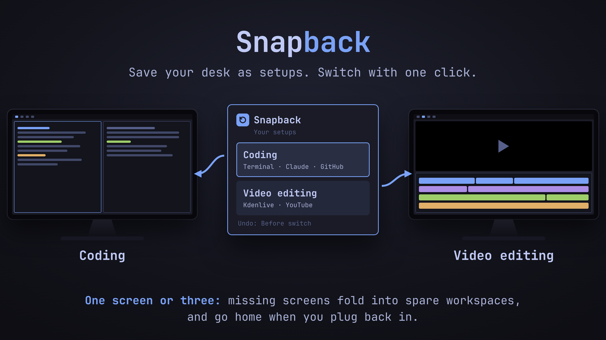

# Snapback

Save your desk as setups. Switch with one click.



Snapback is an Omarchy bar widget. Save the windows you have open as a **setup** (coding, video
editing, browsing and music, a clean desk for gaming) and switch between them from the bar. Click
a setup and your desk becomes it: its apps come back on their screens and workspaces, laid out
the way you left them, and the windows it doesn't have close. Changed your mind? One more click
undoes the switch.

It also keeps your desk saved as you work, and can put it back after a reboot.

## What comes back

- **Every window on its screen and workspace.** Screens are remembered by make, model and serial,
  not by port names like `DP-1` that change when you replug.
- **Tiled layouts, rebuilt.** Apps reopen in any order; Snapback puts the splits back so each
  workspace has the shape you saved.
- **Floating windows** at their size and spot, and **full screen** or **full width** windows that way.
- **Browser tabs, per window.** For Chromium, Google Chrome and Brave, each window comes back with
  its own tabs: your dashboard window with the dashboard, not a blank New Tab.
- **Web apps** (Omarchy's Discord, WhatsApp and the like), **terminals in their folder**, and
  terminal apps opened from Omarchy's menu, such as btop.
- **What each screen was showing.**

Windows already open are used where they can be, so a switch only opens what's missing. New
windows open straight on their own workspace, out of sight, instead of flashing up on the screen in
front of you first.

## Switching setups

- **Click a setup** to switch to it. Windows the setup doesn't have are asked to close, the same
  way their own close button does, so an app with unsaved work can still ask you about it.
  Snapback never kills a window; one that stays open is reported.
- **Undo:** the desk as it was is kept as **Before switch**. Click it to switch back.
- **Pinned windows stay.** A switch never closes a pinned window, nor, while one is pinned, the
  other windows of that app. So a video call keeps going behind its picture-in-picture.
- **Add without closing:** the layers button on a setup puts its windows back and closes nothing.
- **Save open windows as…** under the list adds a setup; the delete button on a setup removes it.

Keys in the panel: arrows (or `j`/`k`) to move, Enter or Space to switch, `a` to add without
closing, `x` or Delete to delete, `s` to name a new setup, Escape to close.

## One screen or three

A setup works on whatever screens you have plugged in.

- **At your desk** every window goes back to its own screen.
- **Somewhere else** (the laptop alone, a different monitor at work), Snapback matches screens by
  role: the setup's main screen goes on your main screen here, side screens on the side you'd
  expect. Windows of screens that aren't there fold into spare workspaces, the way Omarchy itself
  folds an unplugged screen, and Omarchy moves them home when you plug back in.
- **Main screen:** with more than one screen, the panel shows which one Snapback takes as main.
  Click it to choose another. Snapback remembers your choice.

Snapback was built on a three-screen desk. The laptop and docking cases were tested there by
switching screens off and faking a different set of screens, not on a real laptop. If a window
lands somewhere it shouldn't when your screens change,
[open an issue](https://github.com/XimmersiveX/omarchy-snapback/issues) and say which screens you
had when you saved and when you switched.

## Restore at login

Turn on **Restore my windows at login** in the panel. Snapback then keeps your desk saved as
windows change, and puts it back after you log in. It does this with one file,
`~/.config/omarchy/hooks/post-boot.d/snapback`, which Omarchy runs after each login. Turning the
switch off removes it. Nothing is written until you turn it on.

## Install

```bash
omarchy plugin add https://github.com/XimmersiveX/omarchy-snapback --enable
```

Snapback needs nothing beyond what Omarchy already has: it runs on `python3`.
After updating, run `omarchy restart shell` so the bar picks up the new panel.

## Remove

Turn off **Restore my windows at login** first, then:

```bash
omarchy plugin remove io.github.ximmersivex.snapback
```

If you forget the switch, the login hook notices Snapback is gone and deletes itself at the next
login. Your setups stay in `~/.local/state/snapback/` until you delete that folder.

## Good to know

- **Where things live:** setups in `~/.local/state/snapback/sessions/`, readable only by you.
  They hold window titles and, for browsers, tab addresses; nothing leaves your computer.
- **Only installed apps reopen.** Snapback opens apps through their desktop entries (what the app
  launcher uses) or a terminal in a folder. It never replays a saved command line.
- **Terminals come back in their folder, at a fresh prompt.** Programs you started inside a
  terminal, coding agents included, aren't restarted.
- **A browser that's closed** and set to continue where you left off brings back its own last
  session when it starts, so its windows come from there rather than from the setup. With the
  browser already running, a setup's tabs come back exactly.
- **Firefox** windows come back without their tabs. Pinned windows are left alone but not re-pinned.
- **An app Snapback can't place:** if a window's app has no desktop entry Snapback can find, map
  it in `~/.config/snapback/config.toml`:

  ```toml
  [apps]
  "the-window-class" = "the-app.desktop"
  ```

  `never_restore = ["zoom"]` in the same file lists apps never reopened (Zoom by default, so a
  restore never rejoins a call).

## From the command line or a keybinding

```bash
omarchy-shell snapback toggle            # open or close the panel
omarchy-shell snapback switchTo Coding   # switch to a setup
```

The `snapback` command does everything the panel does and more (`status`, `save`, `restore
--dry-run`, `screens`, `doctor`). Run it from the plugin folder:

```bash
cd ~/.config/omarchy/plugins/io.github.ximmersivex.snapback && python3 -m snapback --help
```

## Development

```bash
python3 -m unittest discover -s tests -t .
omarchy plugin validate .
```

The panel's helpers are tested under `node` and its logic in an offscreen Quickshell; those tests
are skipped where either isn't installed. `tools/preview.html` is the source of `preview.png`.

Asked for in omacom/omarchy discussions #2123 and #472, and issues #8535 and #7085.

## License

MIT, see [LICENSE](LICENSE).
